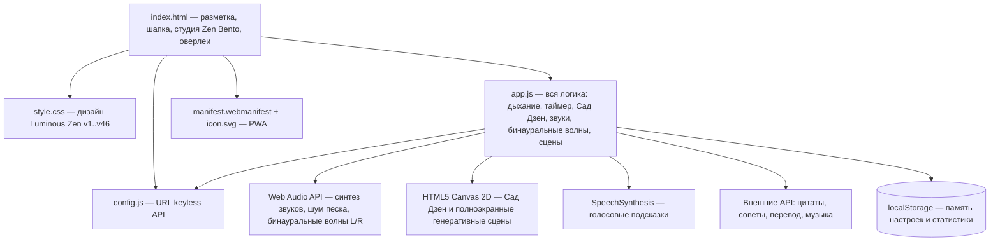

# 🗺️ Карта кодовой базы и граф зависимостей (CODEBASE_MAP.md)

**Проект:** Тихий ум  
**Последнее обновление:** 2026-10-23 22:30 (v46)  

Этот документ помогает любому входящему агенту за 30 секунд понять файловую структуру проекта, назначение каждого модуля и связи между ними.

---

## 🏗️ Архитектурный граф модулей (Component Graph)



---

## 📁 Структура каталогов и файлов проекта

```
Тихий ум/
├── agents/                       # 🧠 «Второй Мозг» проекта (долговременная память)
│   ├── STATUS.md                 # Дашборд состояния
│   ├── AGENT_GUIDE.md            # Главный навигатор
│   └── ...
├── index.html                    # 💻 Разметка: студия Zen Bento, сцена Сада Дзен, оверлей сцен 🌌, пульт ⌘K (v46)
├── style.css                     # 🎨 Весь дизайн: Luminous Zen, Bento-сетка, холсты сада и сцен v1..v46
├── app.js                        # ⚙️ Вся логика: дыхание, таймер, Сад Дзен, 16 звуков, бинауральные волны, живые сцены
├── config.js                     # 🔗 Адреса всех внешних keyless API
├── manifest.webmanifest, icon.svg# 📱 PWA-манифест и иконка
├── .env.example                  # Образец переменных окружения (секретов нет — API keyless)
├── README.md                     # Документация проекта для людей
└── AGENTS.md                     # Входная точка для AI-агентов
```

---

## 📋 Таблица ответственности ключевых файлов

| Путь к файлу / модулю | Назначение и ответственность | Ключевые функции / классы | Что проверить при изменении |
|---|---|---|---|
| `index.html` | Разметка: шапка со сценами `🌌 Сцены`, студия (Дыхание / Таймер / Сад Дзен), Bento-модули (Мысли, Звуки, Техники, Статистика), оверлеи | id-якоря всех секций и кнопок; ссылки `?v=46` на ассеты | После правок — бамп `?v=N` (4 ссылки); сверка id с `$()`-запросами в app.js |
| `style.css` | Весь дизайн версионными блоками (v1…v46 в конце файла) + базовые правила сверху | CSS-переменные `--accent/--text/--line`; темы `body[data-time]`, `[data-oled]`, `[data-season]`, Bento-сетка, Сад Дзен, Scenery HUD | Новые фичи добавляются блоком в конец; `prefers-reduced-motion` гасит декор |
| `app.js` | Вся логика одним файлом: дыхание (PATTERNS + адаптивный чек-ин), таймер, Сад Дзен (песок/вода/камни), звуковой движок (16 звуков), бинауральные волны (L/R panner), генеративные сцены (огонь, океан, звезды) | Единые сеттеры: `setPattern`, `setDurationMin`, `setSoundState`, `setBinaural`, `switchStage`, `openScenery` | Любая фича идёт через сеттер; проверка в браузере: 0 ошибок консоли |
| `config.js` | Конфиг API: wikiquote/advice/dummyjson/mymemory/SoundHelix | `CONFIG` с URL | Замена бэкенда = правка только config.js (формат `{text, author}`) |
| `manifest.webmanifest`, `icon.svg` | PWA: установка на домашний экран | — | Путь к icon.svg относительный |
| `agents/` | Второй мозг: планы, задачи, баги, история, регламенты | `python brain.py <cmd>` | Plan-First: никакого кода без плана в `agents/plans/` |

---

> [!TIP]
> При добавлении или удалении файлов в проекте агент обязан поддерживать эту таблицу в актуальном состоянии!
