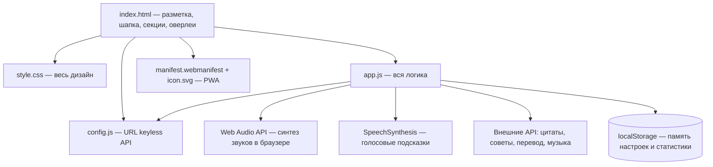

# 🗺️ Карта кодовой базы и граф зависимостей (CODEBASE_MAP.md)

**Проект:** Тихий ум  
**Последнее обновление:** 2026-10-21 22:30  

Этот документ помогает любому входящему агенту за 30 секунд понять файловую структуру проекта, назначение каждого модуля и связи между ними.

---

## 🏗️ Архитектурный граф модулей (Component Graph)



---

## 📁 Структура каталогов и файлов проекта

```
Тихий ум/
├── agents/                       # 🧠 «Второй Мозг» проекта (долговременная память)
│   ├── STATUS.md                 # Дашборд состояния
│   ├── AGENT_GUIDE.md            # Главный навигатор
│   └── ...
├── index.html                    # 💻 Разметка: шапка-капсула, 4 секции, оверлеи, пульт ⌘K
├── style.css                     # 🎨 Весь дизайн: матовое стекло, темы, сезонные акценты
├── app.js                        # ⚙️ Вся логика (~2300 строк): дыхание, таймер, звуки, API
├── config.js                     # 🔗 Адреса всех внешних keyless API
├── manifest.webmanifest, icon.svg# 📱 PWA-манифест и иконка
├── .env.example                  # Образец переменных окружения (секретов нет — API keyless)
├── README.md                     # Документация проекта для людей
└── AGENTS.md                     # Входная точка для AI-агентов
```

---

## 📋 Таблица ответственности ключевых файлов

| Путь к файлу / модулю | Назначение и ответственность | Ключевые функции / классы | Что проверить при изменении |
|---|---|---|---|
| `index.html` | Разметка: шапка-капсула с навигацией, секции «Дыхание/Техники/Таймер/Звуки», оверлей техник, ночник, пульт команд | id-якоря всех секций и кнопок; ссылки `?v=N` на ассеты | После правок — бамп `?v=N` (4 ссылки); сверка id с `$()`-запросами в app.js |
| `style.css` | Весь дизайн версионными блоками (v1…v37 в конце файла) + базовые правила сверху | CSS-переменные `--accent/--text/--line`; темы через `body[data-time]`, `[data-oled]`, `[data-season]` | Новые фичи добавляются блоком в конец; `prefers-reduced-motion` гасит декор |
| `app.js` | Вся логика одним файлом: дыхание (~PATTERNS, startBreath), таймер+якорь, звуковой движок (BUILDERS/SCHEDULERS/MIXES), сцены, пульт ⌘K, мысли, статистика, темы | Единые сеттеры: `setPattern`, `setDurationMin`, `setSoundState`, `mixById`, `setThemePref`, `setNightMode`… — единственный источник правды для чипов/сцен/пульта | Любая фича идёт через сеттер; проверка в браузере: 0 ошибок консоли |
| `config.js` | Конфиг API: wikiquote/advice/dummyjson/mymemory/SoundHelix | `CONFIG` с URL | Замена бэкенда = правка только config.js (формат `{text, author}`) |
| `manifest.webmanifest`, `icon.svg` | PWA: установка на домашний экран | — | Путь к icon.svg относительный |
| `agents/` | Второй мозг: планы, задачи, баги, история, регламенты | `python brain.py <cmd>` | Plan-First: никакого кода без плана в `agents/plans/` |

---

> [!TIP]
> При добавлении или удалении файлов в проекте агент обязан поддерживать эту таблицу в актуальном состоянии!
